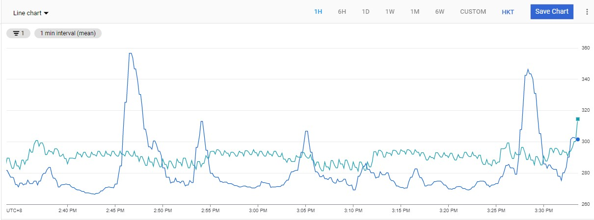

# What is Metrics-Sidecar

`Metrics-Sidecar` monitors the local port usage of Pods:
- How many local ports are in use, grouped by remote address and TCP state.
- How many local ports can be used totally.

It runs in one of two modes:

| Mode | How it runs | Status |
|---|---|---|
| `node` | One collector per node (DaemonSet), reports every Pod on that node | **Recommended** |
| `sidecar` | One extra container in every app Pod, injected by `metrics-sidecar-injector` | Legacy, to be removed after migration |

# Node Mode (DaemonSet)


The collector runs with `hostPID: true`, so it can see every process on the node:

1. It lists the Running Pods on its node from the API server every 30 seconds (`hostNetwork` Pods are skipped).
2. On each scrape it walks `/proc` and maps processes to Pods via the Pod UID in `/proc/<pid>/cgroup`.
3. All containers in a Pod share one network namespace, so it reads `/proc/<pid>/net/tcp` and `tcp6` of one process per Pod.

App Pods need no extra container, label or Service. New Pods and new nodes are covered automatically.

## Deploy

Deploy it as a DaemonSet. The essential parts are:

```yaml
spec:
  template:
    spec:
      serviceAccountName: port-collector   # needs get/list/watch on pods
      hostPID: true
      containers:
      - name: collector
        image: asia.gcr.io/<project_name>/metrics-sidecar:<tag>
        env:
        - name: MODE
          value: node
        - name: NODE_NAME
          valueFrom:
            fieldRef:
              fieldPath: spec.nodeName
        - name: METRICS_SIDECAR_PORT
          value: "9900"
        ports:
        - containerPort: 9900
          name: metrics
```

Expose it with a Service that has the `prometheus.io/scrape: "true"` and `prometheus.io/port` annotations, so the existing `kubernetes-service-endpoints` scrape job picks it up.

| Env | Description |
|---|---|
| `MODE` | `node` |
| `NODE_NAME` | Required, set from `spec.nodeName` via the downward API |
| `POD_SELECTOR` | Optional label selector to limit which Pods are reported, e.g. `raicart.io/metrics-sidecar in (enabled,true,on)` |
| `METRICS_SIDECAR_PORT` | Listen port, default `9999` |

## Metrics

```
# HELP port_total Total Local Port Count
# TYPE port_total gauge
port_total{namespace="<ns>",pod_name="<pod_name>",app="<app>"} 28232
# HELP port_used Used Local Port Count
# TYPE port_used gauge
port_used{namespace="<ns>",pod_name="<pod_name>",app="<app>",remote_addr="<remote_ip> [<remote_port>:<port_name>]",state="ESTABLISHED"} 800
port_used{namespace="<ns>",pod_name="<pod_name>",app="<app>",remote_addr="OTHER",state="TIME_WAIT"} 300
# HELP port_usage Local Port Usage Percentage
# TYPE port_usage gauge
port_usage{namespace="<ns>",pod_name="<pod_name>",app="<app>"} 3.896
# HELP port_collector_pods Pods on this node by collection result
# TYPE port_collector_pods gauge
port_collector_pods{result="collected"} 12
port_collector_pods{result="missing"} 0
```

- **port_used**: How many local ports are in use, grouped by `remote_addr` and `state`. Connections whose remote port is a temporary port (>= 32768) are counted together as `OTHER`.
- **port_total**: How many local ports are available totally (`ip_local_port_range`).
- **port_usage**: `port_used` as a percentage of `port_total`.
- **port_collector_pods**: How many Pods on the node were read (`collected`) or could not be found in `/proc` (`missing`).
- `app` is taken from the Pod label `app.kubernetes.io/name`, `app` or `app.kubernetes.io/instance`.

Differences from sidecar mode:
- IPv6 connections (`tcp6`) are counted as well, so `port_used` and `port_usage` are higher for Pods that accept connections on `::`.
- `port_total` is the collector's own `ip_local_port_range`; Pods that override this sysctl are not detected.

# Sidecar Mode (Legacy)

`MODE=sidecar` is the default and keeps the original behavior. It runs as an extra container named `metrics` in each app Pod and reads the Pod's own `/proc/net/tcp` (IPv4 only), because all containers in a Pod share the same network namespace.


In practice the container is added by `metrics-sidecar-injector` to Pods labeled `raicart.io/metrics-sidecar: enabled`, and each app needs its own `*-metrics` Service with the `prometheus.io/*` annotations. Metrics only have the `pod_name` label:

```
port_used{pod_name="<pod_name>",remote_addr="<remote_ip> [<remote_port>:<port_name>]",state="ESTABLISHED"} 800
port_total{pod_name="<pod_name>"} 28232
port_usage{pod_name="<pod_name>"} 5.667
```

The container never exits even if it fails to get metrics, so it does not affect the app container. Do not set health check probes on it.

# Create Charts for Better Viewing

If you are using GCP Monitoring, you can create a monitoring line chart to show metrics data, click [here](https://cloud.google.com/monitoring/charts/metrics-explorer) for more guidance. Finally, you can see a chart like following.



Or if you are using Grafana, following document may be helpful: https://prometheus.io/docs/visualization/grafana/
